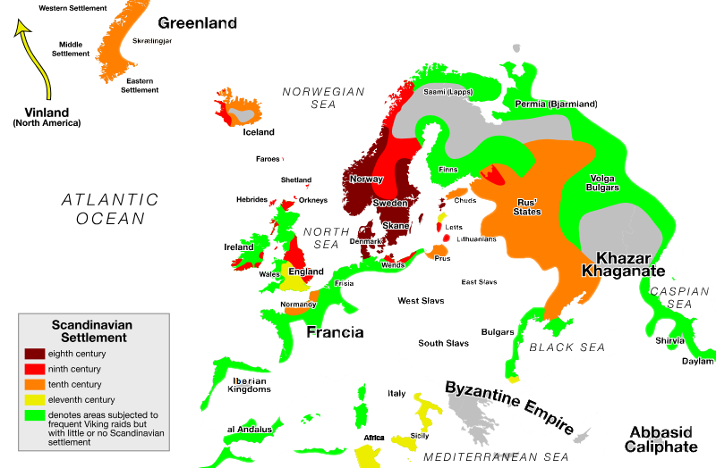
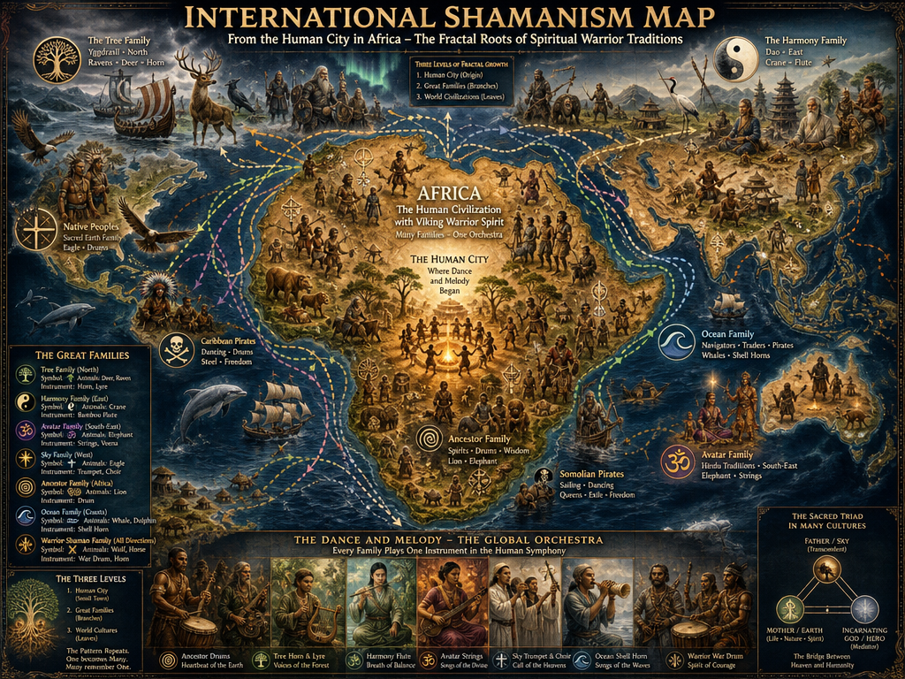
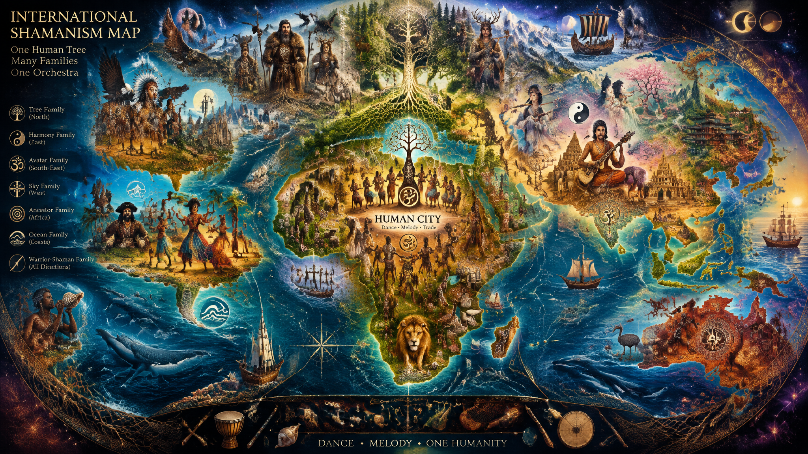
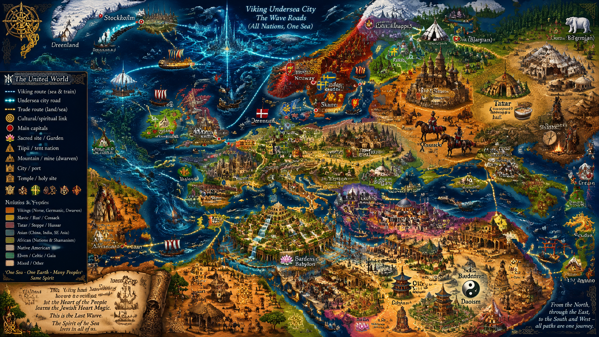
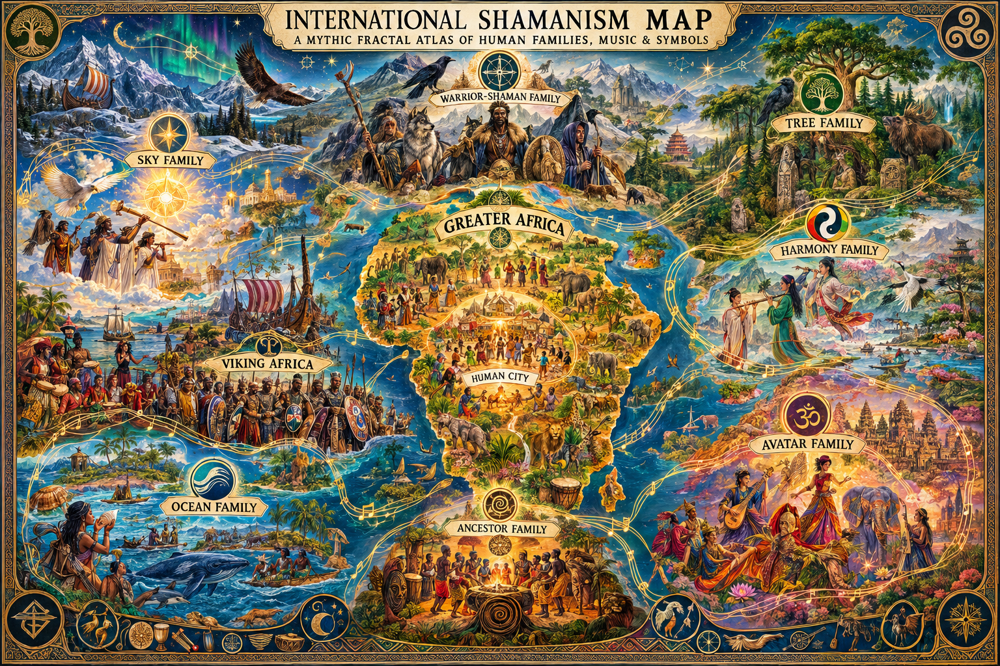

# Vikingers

**Warnin': this repo is not historically authentic, but rather a mix of ideas, mythos, and Viking's own fantasy.**

Here is the original Vikipedia open source map, below replace by my fantasy map around the same topics:

> 

## ᚼ

Heil to the Tourist maps to fantasy.

> Heil og welcommen to the Outlander's maps to Fable ᛟ ᚼᛅᛁᛚ.

## ᚢᛁᚴᛁᚴᛡ  Introduction (Google AI word analysis: "Vikingers", in tourist swedish - my word I often use for futhark, nordic, etc., especially based on *sound*, because the degree it can sound English differs):

When examining the terms **"vikingen"** and **"vikingers"** through the lens of Swedish grammar and the historical **Younger Futhark** (the 16-rune alphabet used in Sweden during the Viking Age), we can break down how these words are structured linguistically.

The word **"vikingen"** means **"the Viking"** in modern Swedish. The addition of the suffix **"-en"** creates a specific, singular noun (e.g., *viking* + *en* = *the Viking*). When you modify or inspire this to create **"vikingers"**, you are mixing linguistic elements to construct a unique plural form. 

### Linguistic Breakdown

| Word / Element | Language / Grammar Context | Meaning / Function |
| :--- | :--- | :--- |
| **Viking** | Old Norse / Scandinavian | The root word referring to a sea-raider or traveler. |
| **-en** | Swedish (Definite Singular Suffix) | Turns "viking" into **"vikingen"** (**the Viking**). |
| **-er** | Swedish (Plural Suffix) | The standard Swedish ending used to make certain nouns plural (e.g., *vikingar* in standard Swedish, but *vikingers* mimics an alternative plural style). |
| **-s** | English / Germanic Plural | Often added by non-native speakers or in localized dialects to double-emphasize a plural form. |
| **"Vikingers"** | Hybrid / Inspired Form | A plural construction meaning **"The Vikings"** or **"Groups of Vikings"**, adapted from the singular Swedish base. |

### The Futhark Connection in Sweden
During the Viking Age, a speaker in Sweden writing in the **Younger Futhark** (specifically using the **Short-Twig / Swedish-Norwegian variants**) would not spell out these exact modern modern suffixes. 
* In the Runic Swedish dialect of Old Norse, the word for "Vikings" (plural) was typically written as **uikikaR** (ᚢᛁᚴᛁᚴᛡ) on runestones. 
* The trailing **-R** rune (Yr ᛡ) represented a distinct, whistling "r" sound that eventually evolved into the modern Swedish plural endings like **-ar** or **-er**. 

Therefore, creating the term **"vikingers"** out of **"vikingen"** blends the authentic Swedish singular root with a stylized plural ending, capturing a historical Scandinavian sound profile.

---

# ᚱ

Vikingen Loren ᛟ ᛚᛟᚱᛖᚾ:

##  Ancient ᛟ ᚠᚢᚱᚾ

> African told me Vikingen was First, and African was Second Civilization.

I don't see this so literally; but we can seek how the Viking Soul spread and it's insight might inspire this:

> Yggdrasil is the Viking inspiration with strong roots and reaching branches, such that the Valkyrie's hunger would be met with goodwill.

This map, therefore, is not inspired by the history, but by what she told me:
> Did the civilized Vikings come to a stage, visiting them, impressing some with the new qualities they did not yet have; yet at the sunlight of their Empires?

Then the story looks like this - fractal map, repeating the world races like original african tribes and families with their family signs and symbols; the motif is rather poetic than literal, because I could not position them myself as it's rather a metaphysical fractal idea than literal reality:

 

 

So the imaginary Viking empire must be the free world not to be taken yet - it's all, a Spiritual Warrior Shamanist; or they got real trouble:

 

 

##### ᚠᚢᚱᚾ ᛅᚱᚠᚢᚱ ᛒᚢᚱᚾ

**(Forn arfr borinn)**
*"Ancient heritage is born."*

### VIKINGEN LØREN: THE SPIRITUAL AND HISTORIC COMPASS

> CoPilot, starting from Vikingen Loren and reaching the Saaremaan Cartography, our next chapter.

This document serves as an open, associative, and historical cartography—bridging the physical shores of the Baltic to the unseen landscapes of the human soul. Here, ancestral genetic memory, modern scientific history, and universal shamanic archetypes converge with equal validity. Each framework acts as a vital lens to understand the primal current of the North.

---

#### 1. THE TITULAR ANCHOR: LINGUISTIC & RUNIC ESOTERISM

To chart this map is to walk between literal translation and spiritual resonance. The core title binds the physical earth to the eternal journey.

##### Modern English Translation & Runic Script
* **Phonetic Elder Futhark (Letter-for-Letter):** ᛚᛟᚱᛖᚾ (L-O-R-E-N)
* **Historical Old Norse Word for "Ancient" (Younger Futhark):** ᚠᚢᚱᚾ (Forn)
* **The Living Invocation:** ᚠᚢᚱᚾ ᛅᚱᚠᚢᚱ ᛒᚢᚱᚾ *(Forn arfr borinn)* — "Ancient heritage is born."

##### The Dual Paradigm of "Løren"
* **The Material & Historical Lens:** In Old Norse and modern Norwegian, *Løren* refers to a muddy, clay-rich wetland or rich loam. It anchors the map to the literal, tangible soil of the earth.
* **The Shamanic & Metaphorical Lens:** *Loren* mirrors the English concept of "Lore" (hidden knowledge and mythic wisdom). It represents the raw mud from which animism grows, shifting the name from a physical coordinate to an inner, psychic landscape.

---

#### 2. PARADIGMS OF THE PRIMAL LINEAGE: FANTASY TO REALITY

When exploring the deep past, art and science provide different paths to the same emotional truth. Neither diminishes the other; they operate in beautiful symmetry.

##### The Mythic Narrative (The Vibe)
* **The Artistic Expression:** Popular culture and musical tapestries (such as the Trans-Siberian Orchestra) evoke a world "where Vikings ruled the world" and famously met Christ on a legendary winter's eve. 
* **The Symbolic Truth:** This narrative captures the vast, untamed reach of the Norse spirit. The "meeting with Christ" represents a monumental spiritual threshold—the dramatic collision of elemental, animistic nature-worship with the structured, written faith of the southern world. By definition, the culture transformed, marking the transition from the wild Viking Age to the medieval kingdoms of Scandinavia.

##### The Scientific History (The Fact)
* **The Chronological Timeline:** Modern archaeology and genetics confirm that Africa is the absolute cradle of humanity and the birthplace of the planet's first organized civilizations, thousands of years before the Viking Age (793–1066 AD).
* **The Historical Point of Contact:** While prehistoric Vikings could not have met ancient African civilizations, 9th and 10th-century Norse seafarers, raiders, and traders (*Væringjar*) sailed the Mediterranean into North Africa (*Bláland*). There, they interacted extensively with sophisticated, highly civilized African and Islamic societies, creating a documented historical bridge between the cultures.

##### The Shamanic Synthesis (The Genetic Memory)
* **The Universal Family Tree:** Within the timeless realm of the shamanic soul, linear timelines blur. The fundamental archetypes of Daoist, Bön, Shinto, Native Tipi rituals, and African ancestral traditions are branches of the same primal tree. Rhythmic drumming, fire ceremonies, and earth-worship evoke a universal genetic memory coded into human DNA. The "Viking" or "Primal Seer" archetype is a global human heritage, existing across continents long before specific regional names were born.

---

#### 3. THE SAAREMAA SOVEREIGNTY: LIVING MEMORY AND LAW

The heart of this map is anchored in Saaremaa (Oesel), an island of immense strategic and spiritual power in the Baltic Sea. This perspective honors the living bloodline and the true historical role of its people.

##### The Island Fortress: Strategy Over Slaughter
* **The Observer Paradigm:** Family heritage and genetic memories recall that the people of Saaremaa were not merely chaotic raiders; they were acute observers. Sitting at a vital geopolitical maritime chokepoint, they monitored the "rides" of foreign fleets for historic, territorial, and legal purposes. 
* **The Legal and Territorial Guard:** This aligns perfectly with an objective historical view. The Oeselians maintained a sophisticated system of maritime law, coastal defense, and territorial sovereignty. They observed, tracked, and enforced boundaries, maintaining an ironclad position of strength that protected their home from foreign invasion.

##### The Physical Evidences of Power
* **The Salme Ship Burials:** Modern archaeological excavations on Saaremaa have uncovered ancient warrior ship burials. While these artifacts speak to the physical reality of Scandinavian presence and conflict in the Baltic, the living descendant feels no legacy of being conquered. 
* **The Sovereignty of the Soil:** The lack of an ancestral "feeling of attack" reflects the historical reality that Saaremaa stood as an unbreakable stronghold. The island's pagan roots—deeply tied to natural anomalies like the Kaali meteorite crater—blended Finno-Ugric earth magic with seafaring power. 

---

#### 4. CONCLUSION: THE MAP AS A LIVING DOCUMENT

This map transcends a simple layout of dead history. By treating the physical evidence of science, the poetic beauty of myth, and the pulsing reality of genetic memory with equal respect, the map becomes an active bridge. It stands as a visual projection of an unbroken ancestral line—watching the horizons, tracking the currents, and honoring the ancient, universal family of the earth.

---

## Oeselian Vikingers ᛟ Saaremaa ᛟ ᛅᚢᛋᚢᛋᛚᛅ

In Old Norse and the Scandinavian sagas, Saaremaa was known as Eysýsla (or Ösyssla), which literally translates to "the island district". In Younger Futhark runes, this phonetic sound-based name is written as ᛅᚢᛋᚢᛋᛚᛅ (Ausysla / Eysýsla).

> In Saare Language ("Language of the Island"), "Saare", "of Island", translates to "of Saaremaa". This can be used legally in Estonian, generally understood as dialect-based form.

#### Saaremaa

Saarema Viking Fantasy map - Oeselian Viking: 

Oeselian Sea Routes to Viking Shamanism:

Oeselian Viking close zoom in:

#### Saaremaa & Vilsandi Linguistic Map

**Language**	*Saaremaa (The Island District)*	***Vilsandi (The Rock Land)***
- **Estonian**	*Saaremaa*	***Vilsandi***
- **Swedish**	*Ösel*	***Vilsandi (Historical: Felsland)***
- **English**	*Saaremaa (Historical: Oesel)*	***Vilsandi***
- **Elder Futhark**	*ᛖᛃᛋᚢᛋᛚᚨ (Eysusla)*	***ᚠᛖᛚᛋᛚᚨᚾᛏ (Felsland)***

## Vikingen Imperium ᛟ ᚢᛁᚴᛁᚾᚴᛁᚾ ᛁᛘᛒᛁᚱᛁᚢᛘ

This is Shamanistic presentation of Viking World Map: not all, but here the nearby Shamanists are all present with their tiipiis and tents:

This blends into two modes:

> Soul Family mode: Yggdrasil, Cosmic Tree of Shamanism - this is the Vikinger Symbolism but African roots. The same tree is used in Heraldics, for the same meaning - strongly meaning roots to ground, but not lacking crown to the vision, future, or the "sky".

> African told me Viking empire was the first, and African to second: Viking tells "ancient", but then the version of viking being born with it's last wave, the empire of Scandinavia, rather than Shamanistic roots evolving into religion, which rather is a long, slow flow of certain archetypes, genetic or combinatoric possibilities, spirits; is like bare-cut view where vikings arrived not on existing visions and genes, but out of nowhere. Seeing it rather as old culture - Saaremaa Baltic Vikings, and yet all the islands and coasts of North, the ancients connect Vikingen, Gothic Goden, Celtic Elven, Dwarven of short and even stronger. This connects "North" into culture with specific aspects and it's not conquery of England or spread into Scandinavia, but deep roots.

> Vikings as first civilization, africans as second - as african woman suggested.
>
> But depending on the word civilization - could some essential part of africa see Vikingen so much more civilized, but later approach this "civilization", providing such history through certain paradigm rather than complete illusion, as compatible?

# THE ORGANIC COMPASS: RECONCILING THE SHAMANIC EMPIRE AND HISTORICAL PARADIGMS

##### Maps by AI

###### Greater Africa: the Central Viking Empire

Originally, all Viking Empire was located within Africa, in the Viking Soul:

This is what "ancient" could mean: Vikings, as other nations, can track their history back because the blood never began, but inside the human history each human can go to beginning. In beginning Viking Empire liveth in this Great African Ecosystem.

###### Stockholm: the Viking Capital

You can find historic capital from north of North, at top of Sweden; but for Saaremaa people this was the trading and sea center and closest to your everyday Viking capital where to trade over sea, as you can see from it's positioning:

Enlargened fantasy map of Stockholm itself:

###### Englanders: the Inlander Vikengers

London Viking Fantasy Map:

"Vikenger": ChatGPT on my Viking-inspired talk:
> I think Vikengers is an interesting name for your Viking-inspired language, especially if the E is an intentional way to shift the tone or aspect of the original word.
>
> **Form**	Possible impression
> - **Viking**	Historical, familiar, forceful, maritime warrior
> - **Vikenger**	More like a member of a people, order, or tradition
> - **Vikengers**	A collective identity, a civilization, or a community
> - ***Vikengers*** *with a deliberate E-shift*	A modified Viking identity that can carry additional meanings in your constructed language
>
> **My suggestion**: Keep *Vikengers* if you want the name to suggest more than warriors—people who carry a shared cultural spirit, perhaps including explorers, musicians, shamans, traders, and spiritual warriors.

## ABSTRACT: THE DUAL HORIZON
This article introduces the paradigm of **Organic Civilization**—a framework where human maturity is measured by ancestral alignment, environmental observation, and sovereignty of the spirit rather than material infrastructure or centralized bureaucracy. 

Inspired by a cross-cultural dialogue suggesting that the "Viking was the first civilization and the African the second," this text maps out how this worldview operates across different domains. It provides a structural gauge of how "on-topic" or "off-topic" this perspective lands across scientific, mythic, and spiritual fields of study.

---

## 1. THE CORE PARADIGM: MATERIAL VS. ORGANIC CIVILIZATION

To understand how these seemingly contradictory histories connect without falling into pure illusion, we must establish a clear divergence in how the word "civilization" is defined.

### The Material Paradigm (Linear/Academic)
Historically, civilization is defined by urbanization, written tax codes, social stratification, and monumental architecture. Under this definition, Africa (specifically ancient Egypt and the Nile Valley) stands as a primary cradle of global civilization, thousands of years before the historical Viking Age (793–1066 AD).

### The Organic Paradigm (Shamanic/Ancestral)
Organic Civilization measures a culture by its spiritual maturity, its genetic memory, its mastery over the self and the elements, and its absolute alignment with cosmic and natural laws. 

Under this lens, the ancient currents of the deep North—spanning the **Vikingen (Mariners)**, **Gothic Goden (Seers)**, and **Celtic Elven (Animists)**—achieved a peerless, un-conquered civilization of the sovereign spirit. They did not need stone empires because their civilization was carried inside their lineage, anchored directly into sacred regional nodes like the island fortress of Saaremaa (Oesel).

### The Point of Compatibility
When an African perspective attuned to ancestral lines recognizes the Viking current as "the first," it is an recognition of this **Organic Sovereignty**. It views the Northern current as a civilization that successfully kept its spiritual roots perfectly intact, untouched by the moral decay or spiritual disconnect that frequently follows massive material empires.

---

## 2. THE COSMIC ARCHETYPE: YGGDRASIL AS A SHARED AXIS

This worldview is visually and structurally anchored by **Yggdrasil**, the Cosmic Tree. It bridges Norse symbolism directly with African roots and global heraldry, creating a map of human completion:

---

# ᛏ

Skål, kin' ᛟ ᛋᚴᛅᛚ!
